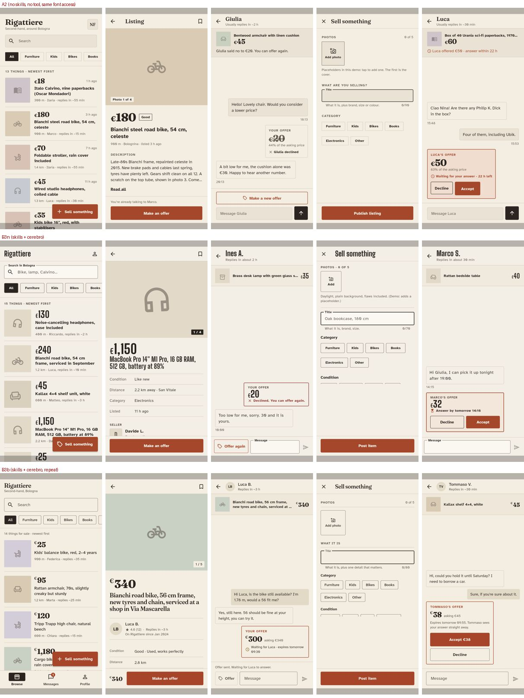
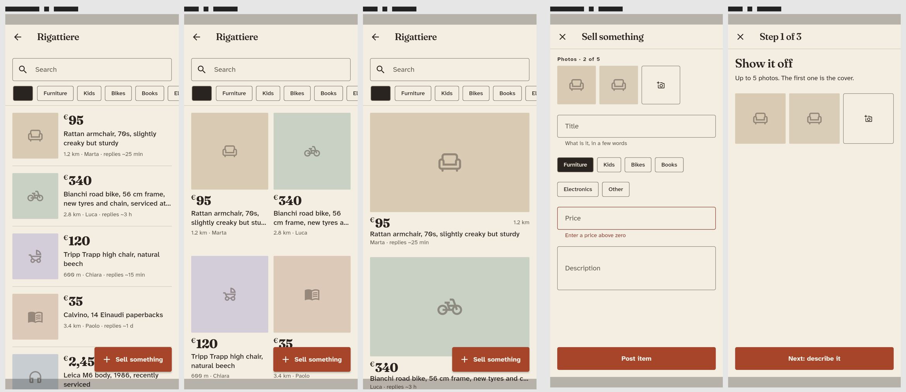
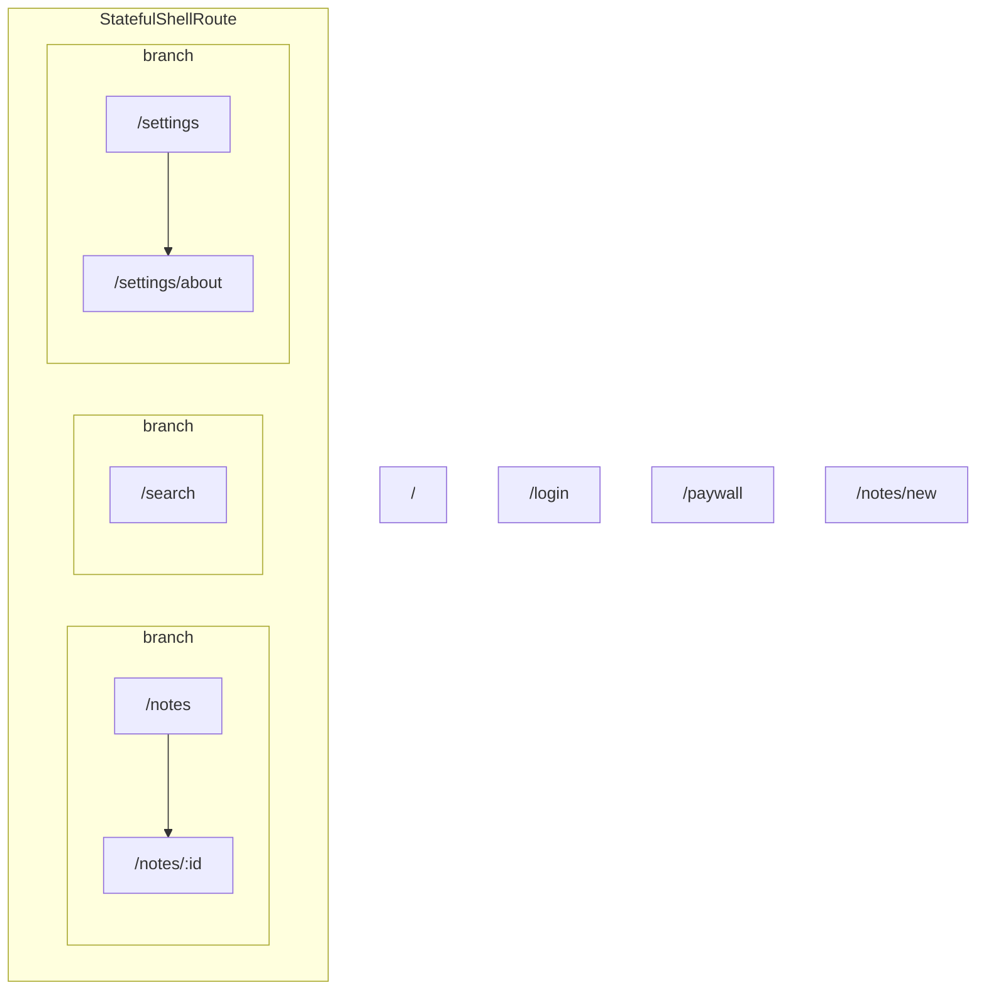

# Cerebro: Flutter UI/UX agent skills + headless screen capture

Two agent skills for **Claude Code** and **Codex CLI** that design and
audit Flutter mobile UI from what the user actually sees, and `cerebro`,
the Dart tool they lean on: one headless screenshot per route (no emulator),
semantics dump, touch-target and contrast measurement, a navigation map
built by tapping every control, and motion evidence for every tap.

```
skills/cerebro-design/     brief → 2-3 rendered prototype directions → build with all states → capture and self-audit
skills/cerebro-audit/     capture every screen, apply a Flutter-specific checklist + Nielsen, write per-screen reports
packages/cerebro/          dart run cerebro init | routes | capture [--explore] | lint | baseline | diff | check
example/demo_app/         go_router app with planted defects, used as fixture
experiments/              the Rigattiere benchmark below: prompts, runner, per-run reports, sheets
```

Works with `go_router` and plain `MaterialApp.routes`, on any host with the
Flutter SDK. Status: v0.1, Apache-2.0. The tool was called `ui_map` until
November 2026; `// ui_map: ignore` comments are still honoured.

## Contents

- [Prerequisites](#prerequisites)
- [Quick start (5 minutes)](#quick-start-5-minutes)
- [Install in your own app](#install-in-your-own-app): [the skills](#1-the-skills), [the tool](#2-the-tool), [the factory](#3-the-factory), [real apps: plugins, network, fonts](#real-apps-plugins-network-fonts)
- [Does it change the result? A benchmark](#does-it-change-the-result-a-benchmark)
- [How it works](#how-it-works)
- [Try it on the demo app](#try-it-on-the-demo-app)
- [Coverage: quick and extended profiles](#coverage-quick-and-extended-profiles)
- [Keep screenshots up to date: baseline, diff, check](#keep-screenshots-up-to-date-baseline-diff-check)
- [Deterministic code rules: `cerebro lint`](#deterministic-code-rules-cerebro-lint)
- [`cerebro.yaml`](#cerebroyaml)
- [Roadmap](#roadmap) · [Licence](#licence)

## Prerequisites

- **Flutter SDK ≥ 3.44** on the `PATH` (`flutter doctor` passes for at
  least one desktop target; no emulator or device is needed). Install from
  <https://docs.flutter.dev/get-started/install>.
- An app that uses **`go_router` ≥ 18** or plain `MaterialApp.routes`.
- **Claude Code** or **Codex CLI** to run the skills.
- **Node.js** only if you install the skills with `npx skills add`; see the
  manual copy below if you prefer not to.

## Quick start (5 minutes)

```bash
git clone git@github.com:mattparadis/cerebro-flutter.git
cd cerebro-flutter/example/demo_app
flutter pub get
dart run cerebro capture          # writes .cerebro/ with 48 screenshots in ~30 s
claude                           # or: codex
```

then ask: *audit the screens of this app*. The demo app ships the skills
under `.claude/skills` and `.agents/skills`, so nothing else is needed.
To use it on your own app, see [Install in your own app](#install-in-your-own-app).

| Skill | Ask for | What it does |
|---|---|---|
| `cerebro-audit` | "audit / review / critique the screens of this app" | captures (or reuses) the map, reads every PNG and semantics dump, applies the checklist and Nielsen's heuristics, writes `.cerebro/audit/<screen>.md` + `SUMMARY.md` with the highest-leverage change |
| `cerebro-design` | "design / prototype / redesign the X screen" | writes a 5-line brief, inherits the app's conventions from the map and theme, then either renders 2-3 prototype directions behind a `UI_PROTO` flag for you to pick, or builds the real screen with all states, captures it and self-audits before presenting |

## Install in your own app

Three pieces: the skills (Markdown folders the agent reads), the `cerebro`
tool (a Dart dev dependency), and the factory file that tells `cerebro`
how to build your app. Run everything from your app's root (where
`pubspec.yaml` is).

### 1. The skills

With Node.js, from your app's root:

```bash
# Claude Code → .claude/skills/<name>, Codex → .agents/skills/<name>
npx skills add mattparadis/cerebro-flutter --skill cerebro-audit
npx skills add mattparadis/cerebro-flutter --skill cerebro-design
```

The CLI asks which agents to install for and remembers the answer: tick
both Claude Code and Codex, or pass `-a claude-code,codex` (or `-a '*'`).
Add `-g` to install for every project instead of the current one.

Or by hand: copy (or symlink) `skills/cerebro-audit` and
`skills/cerebro-design` from a clone of this repo into `.claude/skills/`
(Claude Code) and/or `.agents/skills/` (Codex) inside your app. Each
skill is self-contained: `SKILL.md` plus its `references/` folder.

```bash
git clone git@github.com:mattparadis/cerebro-flutter.git ~/cerebro-flutter
mkdir -p .claude/skills .agents/skills
for s in cerebro-audit cerebro-design; do
  ln -s ~/cerebro-flutter/skills/$s .claude/skills/$s
  ln -s ~/cerebro-flutter/skills/$s .agents/skills/$s
done
```

To make a skill available in every project instead of one, put it under
`~/.claude/skills/` (Claude Code) or `~/.agents/skills/` (Codex).
Restart the agent after installing; verify with `/skills` in Claude Code.

### 2. The tool

```bash
# as a dev dependency (SSH form while the repo is private; needs a GitHub
# account with access to the repo and an SSH key)
dart pub add 'dev:cerebro:{"git":{"url":"git@github.com:mattparadis/cerebro-flutter.git","path":"packages/cerebro"}}'
# or, from a local clone:
dart pub add 'dev:cerebro:{"path":"../cerebro-flutter/packages/cerebro"}'
```

### 3. The factory

```bash
dart run cerebro init           # writes cerebro.yaml + test/cerebro/app_factory.dart
dart run cerebro routes         # lists the locations it will capture; add params in cerebro.yaml
dart run cerebro capture        # .cerebro/map.json, MAP.md, screens/, semantics/
```

`init` leaves two `UnimplementedError` stubs in `app_factory.dart`:
`buildRouter({required String initialLocation})` returns your `GoRouter`
with that initial location, and `buildApp(GoRouter router, {required
ThemeMode themeMode})` returns your root `MaterialApp.router` using that
router and theme mode. Usually both are one-line calls into functions you
already have in `lib/`. The audit skill fills them in itself when it can
find those functions; you only have to do it by hand when the router is
built behind dependency injection the test cannot call.

Add `.cerebro/` to `.gitignore` unless you want the screenshots in the
repo (keep `.cerebro/baseline/` if you use `cerebro check`, see below).

**Navigator 1.0 apps** (`MaterialApp` with `routes:` and `Navigator.pushNamed`,
no go_router): run `dart run cerebro init --navigator`. The factory then
returns only the root widget plus optional `argumentsFor(location)`; route
names are read from the running `MaterialApp`, each screen is opened with
`pushNamedAndRemoveUntil` like a deep link, and explore edges come from the
`ModalRoute` stack. Arguments can also be given in `cerebro.yaml` as
`routes.<name>.args` (YAML values). Apps without a dark theme should set
`themes: [light]`.

### Real apps: plugins, network, fonts

What a medium-sized production app needed to capture cleanly (all of it
lives in `test/cerebro/app_factory.dart` and `cerebro.yaml`, nothing in
`lib/`):

- **Plugins** have no implementation under `flutter test`. Screens that
  await `flutter_secure_storage`, `shared_preferences`, permissions or
  geolocation stay on their spinner forever. Mock the channels in
  `buildApp()` (`SharedPreferences.setMockInitialValues({})`,
  `TestDefaultBinaryMessengerBinding...setMockMethodCallHandler(...)`
  returning `null`/empty maps). Firebase that is only initialised in
  `main()` needs nothing: the factory never runs `main()`.
- **Network**: set `real_async_ms: 500`. The test binding answers every
  HTTP request with 400, so screens settle to their error/empty state
  instead of spinning in the fake-async zone.
- **google_fonts** cannot fetch in tests. Download the TTFs once (OFL)
  into `test/cerebro/fonts/`, set `GoogleFonts.config.allowRuntimeFetching
  = false` in the factory, and list them in `fonts:` under the family
  names google_fonts registers: `<Family>_regular`, `<Family>_500`,
  `<Family>_600`, `<Family>_700`, `<Family>_italic`, `<Family>_700italic`.
  Add a plain `<Family>` entry for `TextStyle(fontFamily:)` uses.
- **Auth guards**: screens that pop when no user is stored land on the
  initial route; `map.json` records `redirected_to` and the audit skill
  reports the redirect once instead of auditing the login screen 20 times.

Routes with `:params` need sample values in `cerebro.yaml` (a list gives one
capture per value, e.g. a live, a sold and a missing item); screens that
hit the network or platform channels at build time will render their
error/empty branch (no HTTP in `flutter test`).

## Does it change the result? A benchmark

I gave the same brief to the same model seven times and compared what came
out. The brief: "Rigattiere", a second-hand marketplace app with five
screens, a precise offer flow (send, double tap, failure and retry, accept,
decline, expire) and a detailed aesthetic direction. The model: Claude
Opus 5.5, headless, same permissions, a fresh empty Flutter project every
time. The only thing that changed between runs is whether the skills and
`cerebro` were available (and, in the later runs, whether fonts could be
downloaded). Prompts, runner and per-run reports are in
[`experiments/`](experiments/).



*Top row: no skills, no tool. Middle and bottom rows: skills + `cerebro`,
two independent runs. Left to right: browse, item, a chat with an offer,
the sell form with the keyboard open, the seller's side of an offer.*

### How I measured

Every finished app was captured with the same `cerebro` configuration: one
phone size, light and dark, text at 1.0× and 1.3×, keyboard open on the
form and the chat, and the explorer tapping every control on every
screen. Four numbers from that capture:

- **Small tap targets**: screens with a control under 48 dp (Android
  minimum). Controls merely cut off by a scroll edge or the keyboard are
  not counted.
- **Low contrast**: screens with text under the WCAG AA ratio for its
  size. Text hidden under a floating button is not counted.
- **Crashes on tap**: controls that throw an exception when tapped.
- **Page transitions**: of all the taps that navigated to another screen,
  how many animated and how many jumped instantly (a Flutter app with no
  page transition looks broken on a phone).

### Results

Three runs had the toolkit, four did not (two of those four had the skills
on disk but never used them, which counts as not having them).

| | Without the toolkit (4 runs) | With skills + `cerebro` (3 runs) |
|---|---|---|
| Screens with small tap targets | 0 to **28** | 0 |
| Screens with low contrast | 5 to **16** | 2 to 5 |
| Crashes on tap | 2 of 4 runs had one | none |
| Page transitions animated / instant | 0-9 animated, 37-48 instant | **43-46 animated, 0-5 instant** |
| Prototype step before building | never | 3 directions per key screen, rendered and scored |
| Time and cost per run | 24-39 min, $6-8 | 32-33 min, $9.5-9.7 |

What this says, in plain words:

1. **Without a capture loop nothing animates and nobody notices.** In
   every run without the tool, go_router silently used pages with no
   transition. The agents with `cerebro` saw `instant` next to each
   navigation in their own capture, fixed it and wrote a regression test.
2. **The tool finds the bugs the agent cannot see.** Two independent
   no-tool runs shipped the same crash (scrolling a list that is not on
   screen). The explorer reports it as a tap that throws.
3. **Process becomes stable, taste stays open.** The three toolkit runs
   share structure and measured quality but chose three different display
   typefaces and disagreed on a bottom bar. That is exactly what the
   prototype step is for: a person picks among rendered directions.
4. **Fonts were not the trick.** A no-tool run that was allowed to
   download the same fonts still shipped with instant transitions, no
   prototype step and no capture.



*The prototype step as the agent sees it: `cerebro` renders the directions
side by side (`.cerebro/proto/<screen>.png`). Someone picks one before
anything is built.*

<details>
<summary>Every run</summary>

| Run | Skills | `cerebro` | Fonts downloadable | Small targets | Low contrast | Crash on tap | Transitions animated / instant |
|---|---|---|---|---|---|---|---|
| no toolkit | no | no | no | 28 | 6 | 1 | 0 / 40 |
| skills on disk, never invoked | listed | no | no | 0 | 16 | 1 | 0 / 43 |
| skills used, tool never run | yes | installed, not run | no | 0 | 6 | 0 | 9 / 48 |
| no toolkit, fonts downloadable | no | no | yes | 2 | 5 | 0 | 9 / 37 |
| toolkit | yes | yes | yes | 0 | 5 | 0 | 45 / 5 |
| toolkit, repeat | yes | yes | yes | 0 | 3 | 0 | 43 / 5 |
| toolkit, no mention of it in the prompt | self-triggered | yes | yes | 0 | 2 | 0 | 46 / 0 |

Numbers are screens (out of 84-96 captures per run) or taps. Full tables,
every finding with its status, and the comparison sheets:
[`experiments/rigattiere-results.md`](experiments/rigattiere-results.md).

</details>

Limits worth stating: one brief, one model, three runs with the toolkit
and one each for the other arms; the first "with skills" run was not
better than the baseline, it had simply not used the skills, which is why
the trigger was fixed and the run repeated.

## How it works

1. `dart run cerebro init` scaffolds `cerebro.yaml` and
   `test/cerebro/app_factory.dart`, where you expose two functions:
   `buildRouter({required String initialLocation})` and
   `buildApp(GoRouter router, {required ThemeMode themeMode})`.
2. `dart run cerebro capture` runs a generated `flutter test` that walks
   `router.configuration.routes` (GoRoute, ShellRoute, StatefulShellRoute
   branches), opens the app on every location, renders it at the configured
   device sizes in light and dark, and writes:

   | File | Content |
   |---|---|
   | `.cerebro/map.json` | summary, fonts report, route tree, skipped routes, one entry per screen (png, semantics, layout exceptions, `tappables_below_min`, `low_contrast` with measured WCAG ratios, sha256) |
   | `.cerebro/MAP.md` | navigation tree as Mermaid + thumbnail table |
   | `.cerebro/screens/*.png` | screenshots with real Roboto / Material Icons glyphs; simulated system insets drawn as translucent bands so missing `SafeArea` is visible |
   | `.cerebro/semantics/*.txt` | semantics tree dump, deterministic across runs |

3. The `cerebro-audit` skill reads the map and the images, applies a
   Flutter-specific checklist (hierarchy, type scale, contrast, touch
   targets, states, navigation idiom, dark mode) and writes
   `.cerebro/audit/<screen>.md` plus `SUMMARY.md` with the single
   highest-leverage change.

With `--explore` (or `explore: true`), the harness also taps every
semantics target of each screen on a fresh instance and records where it
leads: a `push`, `pop` or `go` to another location, an overlay (dialog,
sheet, snackbar), an `error` (for instance "nothing to pop" on a screen
reached by deep link), a `state_change` (same page, semantics tree
changed: filter, expand, page swipe) or `no_observed_effect`. `map.json`
gets `edges` and `no_effect_taps` (suspects, not confirmed defects); `MAP.md` gets a second Mermaid graph with the **real**
navigation edges labelled by the control that triggers them. On the demo
this takes about 20 s for 62 taps.

Every explored edge also carries **motion evidence**: frames are sampled
every 50 ms after the tap with the tapped rect masked (ink ripples do not
count), so `transition` is `animated` (with `transition_ms`), `instant`,
`continuous` (still moving after 600 ms: spinner, shimmer or a leak) or
`unknown` (the screen was already animating). `instant` on a `push`/`pop`
means page transitions are off; `instant` on the state change behind the
screen's main action means it ships without feedback motion. The summary
counts `animated_transitions` and `instant_transitions`.

Two classes keep the numbers honest: a tappable cut by the edge of its
scroll view or by the keyboard inset is listed under `tappables_clipped`
(its real size is unknown) instead of `tappables_below_min`, and a text
whose rect is crossed by a FAB or a sticky button, or whose measured ratio
is below 1.3:1, goes to `contrast_not_measurable` with reason
`occluded by "<label>"` rather than to `low_contrast`. Each explored edge
also has `self_transition`, the motion inside the tapped control itself.

Prototype routes (`/__proto/<name>`, captured with `-D UI_PROTO=true`) are
also composed into one sheet per screen, `.cerebro/proto/<name>.png` (one
column per direction, one row per theme), listed in `.cerebro/PROTO.md`.

Large-text variants (`text_scales: [1.0, 1.3]`) and prototype routes
(`dart run cerebro capture -D UI_PROTO=true`) are captured the same way.

Screen **states** come from two mechanisms. **Scenarios** are named
fixtures in `test/cerebro/app_factory.dart` (`scenarios: {'empty': () async
=> FakeRepo.items = [], 'logged-in': ...}` plus a `resetScenario` that runs
before every screen); `cerebro.yaml` applies them per route
(`routes."/orders".scenarios: [empty, error]`) or to every screen
(`default_scenario: logged-in`). Each becomes a screen with an `__s-<name>`
id. They work with any architecture that has a test seam (a static
override, a DI container, an in-memory repository) and need no URL support.
Alternatively, **URL variants** are addressed as locations: a list screen that reads
`?state=empty|loading|error` from `GoRouterState.uri.queryParameters` can
be captured in every state by listing `variants` in `cerebro.yaml`. No
test-only wiring needed.

## Try it on the demo app

```bash
cd example/demo_app
flutter pub get
dart run cerebro routes                     # 12 locations, incl. /notes?state=empty|loading|error
dart run cerebro capture                    # 48 PNGs (12 locations × light/dark × 1.0/1.3 text) in ~30 s
dart run cerebro capture -D UI_PROTO=true   # + the two prototype directions under /__proto/note-detail
dart run cerebro capture --explore          # + real navigation edges by tapping every target
```

The generated `MAP.md` starts with the route tree:



and `map.json` already carries deterministic findings, for example on
`/settings` and `/notes`:

```json
"tappables_below_min": [
  { "label": "Edit profile", "x": 337.0, "y": 120.0, "width": 32.0, "height": 32.0,
    "nested_in_larger_target": false }
],
"low_contrast": [
  { "text": "Today, 09:12", "ratio": 1.69, "required": 4.5,
    "fg": "#BDBDBD", "bg": "#EEF4F1", "font_size": 11.0, "x": 32.0, "y": 170.0, ... }
]
```

Contrast is measured, not estimated: the text colour comes from the
rendered `RenderParagraph`, the background is sampled from the screenshot
under it, and the threshold follows WCAG AA (4.5, or 3.0 for large text).
`contrast_coverage` says how many texts were measured and
`contrast_not_measurable` lists the rest with a reason, so absence from
`low_contrast` is a pass only for measured texts.

Then, in the same directory, ask Claude Code or Codex:

> audit the screens of this app

The skill is discovered through `.claude/skills` and `.agents/skills`
symlinks in the demo app. The planted defects it should find: a 32×32 dp
icon button on Settings, a `#BDBDBD` caption on the notes list, a hardcoded
light background on the paywall that stays light in dark mode, onboarding
content without `SafeArea`, and a login form that overflows by 68 px when
the keyboard is open (visible only in the `__kb` capture). The note
creation flow, on the other hand, is a worked example of a flow contract:
`test/flows/create_note_flow_test.dart` proves persistence, in-flight
protection, error + retry and discard confirmation against the in-memory
repository.

## Coverage: quick and extended profiles

`map.json` has a `coverage` block and `MAP.md` a "Coverage" section
listing what was executed and, explicitly, what was not (dark theme, iOS,
large text, other locales, keyboard open, explore, device-only checks).
The audit skill reports anything not executed as not verified. Two
profiles:

| Profile | `cerebro.yaml` |
|---|---|
| quick (PRs) | one phone, light (+dark), android, `text_scales: [1.0]` |
| extended (releases) | `devices: [{name: small, width: 360, height: 640, dpr: 2}, {name: phone, ...}]`, `themes: [light, dark]`, `platforms: [android, ios]`, `text_scales: [1.0, 1.3, 2.0]`, `locales: [en, it, ar]`, `keyboard: true` on form routes, `--explore` |

`skills/cerebro-audit/references/device-checks.md` lists the 13 checks
that need a device (screen reader order, back gesture, real keyboard,
reduce motion, permissions, offline) with steps and pass criteria.

## Keep screenshots up to date: baseline, diff, check

```bash
dart run cerebro capture      # current state
dart run cerebro baseline     # copy it to .cerebro/baseline/ (commit this in your app)
# ... change the app ...
dart run cerebro check        # capture + diff; exit 1 on regressions
```

`check` writes `.cerebro/diff.json` and `.cerebro/DIFF.md` (before/after
thumbnails) and classifies each change as **regression** (a finding that was
not in the baseline, compared by identity: label or text plus size or
contrast ratio, so a fixed defect next to a new one still surfaces the new
one; or a screen that stopped rendering), **coverage loss** (fewer texts
measurable than before), **improvement** (findings fixed), or plain visual /
semantics change. Hashes are deterministic, so an unchanged screen never
shows up. `--fail-on regression` (default) blocks on regressions,
`--fail-on coverage` also on coverage loss, `--fail-on any` on every pixel
change, `--fail-on none` only reports.

Pre-commit hook (`.git/hooks/pre-commit` or your hook manager):

```sh
#!/bin/sh
if git diff --cached --name-only | grep -qE '^(lib/|cerebro.yaml|pubspec.yaml)'; then
  dart run cerebro check || { echo "cerebro: UI regressions, see .cerebro/DIFF.md"; exit 1; }
fi
```

GitHub Actions step (after `flutter pub get`):

```yaml
- run: dart run cerebro check --fail-on regression
- uses: actions/upload-artifact@v4
  if: always()
  with: { name: cerebro, path: .cerebro }
```

When a change is intentional, run `dart run cerebro baseline` again and
commit the new baseline with the code; the agent reading `DIFF.md` can
tell you which screens to look at before you do.

## Deterministic code rules: `cerebro lint`

```bash
dart run cerebro lint            # .cerebro/lint.json + LINT.md, exit 1 on errors
dart run cerebro lint --lint-fail-on warning
```

Regex rules for the design defects the Dart analyzer does not know about,
each with `file:line`: `hardcoded-color`, `literal-font-size`,
`empty-handler`, `small-icon-button`, `deprecated-will-pop-scope`,
`platform-io-check`, `no-safe-area`, `network-image-no-error-builder`,
`gesture-without-semantics`, `pump-and-settle` (tests). Severities:
`error` and `warning` are structural defects; `hardcoded-color` and
`literal-font-size` are `convention` findings, defects only when the
rendered result is wrong. `// cerebro: ignore <reason>` on a line is a
motivated exception. Theme files and generated code are excluded by
default; tune `lint.exclude` and `lint.rules` in `cerebro.yaml`. `check`
runs capture, diff and lint together.

## `cerebro.yaml`

```yaml
devices:
  - { name: phone, width: 393, height: 852, dpr: 3, safe_area: { top: 24, bottom: 24 } }
themes: [light, dark]
platforms: [android]        # android | ios
text_scales: [1.0, 1.3]     # large-text variants get an __x1.3 id suffix
settle_ms: 600              # fixed pumps; infinite spinners are fine
drain_timers_ms: 120000     # fake time pumped after each capture so one-shot
                            # timers (snack bars, fake backends) do not fail the test
export_scale: 2             # PNG = logical size × 2
min_tap_size: { android: 48, ios: 44 }   # per platform, or one number
keyboard_inset: 300         # dp, for routes with keyboard: true
locales: []                 # e.g. [en, it, ar]; others get an id suffix
routes:
  "/notes/:id": { params: { id: "1" } }
  "/items/:id": { params: { id: [i01, i07, nope] } }   # list = one capture per value;
                                                      # variants/keyboard use the first
  "/notes":     { variants: ["?state=empty", "?state=loading", "?state=error"], scenarios: [empty] }
  "/login":     { keyboard: true }   # extra capture with the keyboard open (__kb)
  "/debug":     { skip: true }
exclude: []
fonts: {}                   # family -> font files, for custom fonts
out_dir: .cerebro
explore: false              # tap every target and record navigation edges
explore_max_taps: 40
lint:
  exclude: ["**/*.g.dart", "**/theme.dart", "**/theme/**"]
  rules: { no-safe-area: false }   # disable a rule
```

## Roadmap

- MCP wrapper, Android emulator capture for native plugins, auto_route
  support, network image mocking.

## Licence

Apache-2.0. See `NOTICE` for the projects whose checklist ideas are reused.
