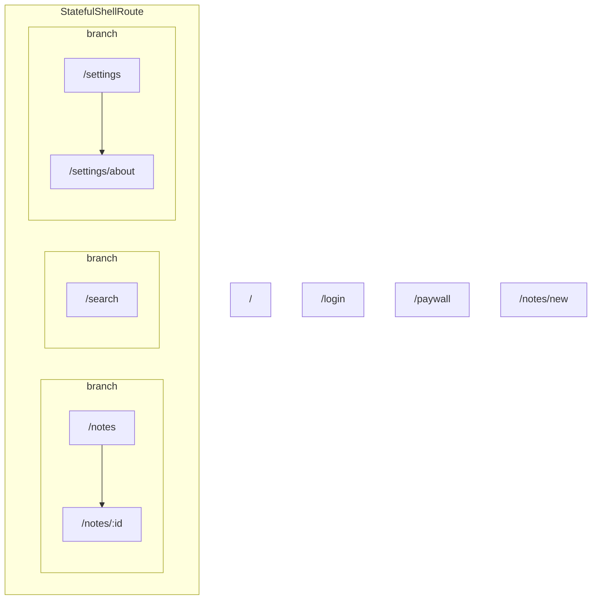

# Flutter UI/UX agent skills + `ui_map`

Agent skills for **Claude Code** and **Codex CLI** that design and audit
Flutter mobile UI/UX from what the user actually sees, backed by `ui_map`:
a small Dart tool that captures one screenshot per `go_router` route
**headlessly** (no emulator, no device), dumps the semantics tree, flags
touch targets below the minimum, and builds a navigation map the agent can
read.

Status: **v0.1**. Two skills, one tool, one demo app. Works on Linux,
macOS and Windows hosts with the Flutter SDK only.

```
skills/audit-screens/     audit existing screens: checklist (40 items), Nielsen heuristics, report template
skills/design-screen/     design new screens: prototype mode (2-3 directions as PNGs) and build mode,
                          with Material 3, Apple HIG / Cupertino, patterns and anti-pattern references
packages/ui_map/          Dart package: `dart run ui_map init | routes | capture`
example/demo_app/         Flutter app with planted design defects, used as fixture
```

| Skill | Ask for | What it does |
|---|---|---|
| `audit-screens` | "audit / review / critique the screens of this app" | captures (or reuses) the map, reads every PNG and semantics dump, applies the checklist and Nielsen's heuristics, writes `.ui-map/audit/<screen>.md` + `SUMMARY.md` with the highest-leverage change |
| `design-screen` | "design / prototype / redesign the X screen" | writes a 5-line brief, inherits the app's conventions from the map and theme, then either renders 2-3 prototype directions behind a `UI_PROTO` flag for you to pick, or builds the real screen with all states, captures it and self-audits before presenting |

## How it works

1. `dart run ui_map init` scaffolds `ui_map.yaml` and
   `test/ui_map/app_factory.dart`, where you expose two functions:
   `buildRouter({required String initialLocation})` and
   `buildApp(GoRouter router, {required ThemeMode themeMode})`.
2. `dart run ui_map capture` runs a generated `flutter test` that walks
   `router.configuration.routes` (GoRoute, ShellRoute, StatefulShellRoute
   branches), opens the app on every location, renders it at the configured
   device sizes in light and dark, and writes:

   | File | Content |
   |---|---|
   | `.ui-map/map.json` | summary, fonts report, route tree, skipped routes, one entry per screen (png, semantics, layout exceptions, `tappables_below_min`, sha256) |
   | `.ui-map/MAP.md` | navigation tree as Mermaid + thumbnail table |
   | `.ui-map/screens/*.png` | screenshots with real Roboto / Material Icons glyphs; simulated system insets drawn as translucent bands so missing `SafeArea` is visible |
   | `.ui-map/semantics/*.txt` | semantics tree dump, deterministic across runs |

3. The `audit-screens` skill reads the map and the images, applies a
   Flutter-specific checklist (hierarchy, type scale, contrast, touch
   targets, states, navigation idiom, dark mode) and writes
   `.ui-map/audit/<screen>.md` plus `SUMMARY.md` with the single
   highest-leverage change.

Large-text variants (`text_scales: [1.0, 1.3]`) and prototype routes
(`dart run ui_map capture -D UI_PROTO=true`) are captured the same way.

Screen **states** are addressed as locations: a list screen that reads
`?state=empty|loading|error` from `GoRouterState.uri.queryParameters` can
be captured in every state by listing `variants` in `ui_map.yaml`. No
test-only wiring needed.

## Try it on the demo app

```bash
cd example/demo_app
dart run ui_map routes                     # 12 locations, incl. /notes?state=empty|loading|error
dart run ui_map capture                    # 48 PNGs (12 locations × light/dark × 1.0/1.3 text) in ~30 s
dart run ui_map capture -D UI_PROTO=true   # + the two prototype directions under /__proto/note-detail
```

The generated `MAP.md` starts with the route tree:



and `map.json` already carries deterministic findings, for example on
`/settings`:

```json
"tappables_below_min": [
  { "label": "Edit profile", "x": 337.0, "y": 120.0, "width": 32.0, "height": 32.0,
    "nested_in_larger_target": false }
]
```

Then, in the same directory, ask Claude Code or Codex:

> audit the screens of this app

The skill is discovered through `.claude/skills` and `.agents/skills`
symlinks in the demo app. The planted defects it should find: a 32×32 dp
icon button on Settings, a `#BDBDBD` caption on the notes list, a hardcoded
light background on the paywall that stays light in dark mode, and
onboarding content without `SafeArea`.

## Install in your own app

```bash
# the skill (Claude Code → .claude/skills, Codex → .agents/skills)
npx skills add <this-repo-url> --skill audit-screens

# the tool, as a dev dependency
dart pub add --dev 'ui_map:{"git":{"url":"<this-repo-url>","path":"packages/ui_map"}}'
dart run ui_map init
```

Requirements: Flutter ≥ 3.44, `go_router` ≥ 18. Routes with `:params` need
sample values in `ui_map.yaml`; screens that hit the network or platform
channels at build time will render their error/empty branch (no HTTP in
`flutter test`).

## `ui_map.yaml`

```yaml
devices:
  - { name: phone, width: 393, height: 852, dpr: 3, safe_area: { top: 24, bottom: 24 } }
themes: [light, dark]
platforms: [android]        # android | ios
text_scales: [1.0, 1.3]     # large-text variants get an __x1.3 id suffix
settle_ms: 600              # fixed pumps; infinite spinners are fine
export_scale: 2             # PNG = logical size × 2
min_tap_size: 48
routes:
  "/notes/:id": { params: { id: "1" } }
  "/notes":     { variants: ["?state=empty", "?state=loading", "?state=error"] }
  "/debug":     { skip: true }
exclude: []
fonts: {}                   # family -> font files, for custom fonts
out_dir: .ui-map
```

## Roadmap

- Deterministic code-rule detector (hardcoded colours, missing SafeArea,
  small targets in source) and a contrast measurement in `ui_map`.
- Dynamic navigation edges (NavigatorObserver), diff between captures,
  pre-commit / CI hook, MCP wrapper, Android emulator capture for native
  plugins, Navigator 1.0 / auto_route support.

## Licence

Apache-2.0. See `NOTICE` for the projects whose checklist ideas are reused.
